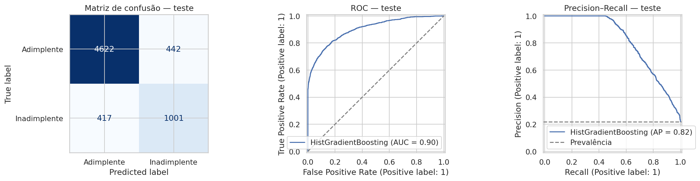

# Predição de Risco de Crédito e Inadimplência

[](https://colab.research.google.com/)
[](LICENSE)

Projeto acadêmico de **classificação binária com dados tabulares**: estimar um score de risco de inadimplência a partir do perfil econômico de um solicitante.

- `loan_status = 1`: inadimplência; `loan_status = 0`: adimplência.
- Python, pandas, NumPy, matplotlib, seaborn e scikit-learn.
- **Roda em CPU**, localmente ou no Google Colab; não exige GPU nem TensorFlow.
- Repositório: <https://git.sr.ht/~jabuxas/2026-2-credit-risk-prediction>.

> Experimento com dados simulados, não um sistema de concessão de crédito. O score não é uma probabilidade calibrada nem uma avaliação de caráter. Não deve fundamentar aprovação/recusa automática.

## Dados e prevenção de vazamento

Fonte: [Credit Risk Dataset — Lao Tse, Kaggle](https://www.kaggle.com/datasets/laotse/credit-risk-dataset), **versão 1**, licença **CC0**, 32.581 registros e 12 colunas. O autor descreve a base como simulação de dados de bureau de crédito; moeda, horizonte do default e mecanismo de simulação não são documentados.

O notebook baixa a versão fixada e verifica o SHA-256 do CSV. Não há fallback para outra base. Se o download for bloqueado, baixe o CSV original e configure `DATA_PATH` no notebook. Não inclua credenciais ou CSVs no Git.

Usamos nove preditores: idade, renda anual, tempo de emprego, moradia, finalidade, valor do empréstimo, razão empréstimo/renda, histórico anterior de inadimplência e duração do histórico de crédito. **Excluímos `loan_grade` e `loan_int_rate`**, pois podem refletir uma análise prévia da instituição; sua disponibilidade antes da decisão não é assegurada.

1. Limpeza por regras explícitas: 165 duplicatas completas e 7 registros impossíveis removidos; restam **32.409** linhas. Os limites de plausibilidade estão documentados no notebook.
2. Divisão estratificada, semente 42: **19.445 treino / 6.482 validação / 6.482 teste**, aproximadamente 60/20/20.
3. Imputação por mediana/moda e One-Hot Encoding ajustados **só no treino**, dentro de `Pipeline`/`ColumnTransformer`. `StandardScaler` apenas na regressão logística.
4. Modelo e limiar escolhidos pelo **F1 da classe 1 na validação**. O teste não participa dessa escolha. Não há retreinamento após ajustar o limiar.

## Por que estes modelos?

| Modelo | Papel no experimento |
| --- | --- |
| DummyClassifier | Referência ingênua, sem usar o perfil do cliente |
| Regressão logística | Baseline linear regularizado, simples e barato |
| Árvore de decisão | Regras não lineares, com profundidade limitada a 5 |
| Random Forest | Combina 200 árvores para reduzir variância |
| HistGradientBoosting | Boosting eficiente para dados tabulares de médio porte |

Não impomos Deep Learning: redes densas não têm vantagem garantida neste tipo de base. CatBoost, XGBoost e LightGBM são alternativas para experimentos futuros; primeiro comparamos modelos disponíveis no próprio scikit-learn, com hiperparâmetros fixos e sem acrescentar dependências pesadas.

## Resultados reais da execução de referência

Métricas da classe **inadimplente**, com o limiar de cada modelo escolhido na validação. A ordem segue o F1 da validação, **não uma escolha posterior pelo teste**.

| Modelo | F1 validação | F1 teste | Recall teste | ROC-AUC teste |
| --- | ---: | ---: | ---: | ---: |
| **HistGradientBoosting** | **0,6957** | **0,6998** | **0,7059** | **0,9016** |
| Random Forest | 0,6713 | 0,6842 | 0,6058 | 0,8758 |
| Árvore de decisão | 0,6167 | 0,6366 | 0,5331 | 0,8208 |
| Regressão logística | 0,5685 | 0,5585 | 0,5719 | 0,8041 |
| Dummy (prior) | 0,3590 | 0,3590 | 1,0000 | 0,5000 |

**Selecionado:** HistGradientBoosting, limiar **0,259819**. No teste: precision **0,6937**, Average Precision **0,8160**, acurácia **0,8675**. A Random Forest tem acurácia maior, mas perde no critério F1. O Dummy, ao otimizar F1, sinaliza todos como risco; no limiar padrão 0,5, ele prevê apenas adimplência e tem F1 zero.

F1 é uma convenção acadêmica, não uma função de custo financeiro. Reportamos também a curva Precision–Recall, ROC e matriz de confusão. **Average Precision (AP)** resume a curva PR; não é a área calculada por integração trapezoidal.



Os valores completos, versões das bibliotecas, parâmetros, auditoria da limpeza e fingerprint dos dados estão em [`results/metrics.json`](results/metrics.json). São resultados de uma única divisão, sem intervalos de confiança; não demonstram desempenho em crédito real. Detalhes em [`relatorio.md`](relatorio.md).

## Como executar

### Google Colab

O SourceHut não tem a integração de abertura direta do GitHub com o Colab. O selo acima abre o Colab, **não importa automaticamente o arquivo**:

1. Baixe [`notebooks/01_credit_risk_prediction.ipynb`](notebooks/01_credit_risk_prediction.ipynb) deste repositório.
2. No Colab, escolha **Arquivo → Fazer upload de notebook** e selecione o arquivo.
3. Use ambiente **Python 3 / CPU** e execute todas as células, na ordem. As bibliotecas de modelagem costumam estar disponíveis no Colab; as versões usadas aparecem na primeira saída.
4. Para reproduzir as versões de referência, instale os pacotes de `requirements.txt` antes das importações e reinicie a sessão se já tiver importado versões diferentes.

O notebook é autocontido: não precisa importar arquivos Python do repositório. As figuras e métricas são salvas em `results/` no ambiente em execução; baixe-as antes de encerrar o Colab.

### Execução local reproduzível

Ambiente de referência: **Python 3.12.13**, com versões diretas fixadas em `requirements.txt`. Não execute o notebook antigo de livros, que foi substituído.

```bash
git clone https://git.sr.ht/~jabuxas/2026-2-credit-risk-prediction
cd 2026-2-credit-risk-prediction
python3.12 -m venv .venv
source .venv/bin/activate
python -m pip install -r requirements.txt
python -m unittest discover -s tests -v
python scripts/run_notebook.py
```

O script executa o notebook inteiro em kernel novo, baixa a base e gera métricas e quatro figuras. Uma cópia com saídas fica em `results/executed.ipynb` (ignorada pelo Git); o notebook-fonte permanece sem saídas. Os **14 testes offline** verificam formato Jupyter, esquema/alvo, fingerprint, limpeza, separação, imputação sem vazamento, categorias novas, métricas e seleção do limiar.

## Estrutura

```text
2026-2-credit-risk-prediction/
├── README.md
├── relatorio.md
├── LICENSE
├── .gitignore
├── requirements.txt
├── notebooks/
│   └── 01_credit_risk_prediction.ipynb
├── scripts/
│   └── run_notebook.py
├── tests/
│   └── test_notebook.py
└── results/
    ├── metrics.json
    ├── 01_exploration.png
    ├── 02_validation.png
    ├── 03_importance.png
    └── 04_test_evaluation.png
```

## Ética e licença

Idade, renda e moradia podem reproduzir vieses ou servir como proxies socioeconômicos. A base não permite concluir que o modelo é justo, representativo ou adequado ao Brasil. Uso real exigiria fundamento legal sob LGPD, validação temporal, calibração, auditoria de subgrupos, monitoramento e revisão humana com contestação.

Código sob [MIT](LICENSE); dados sob **CC0**, conforme a fonte. Nenhum dado individual ou credencial é versionado.
